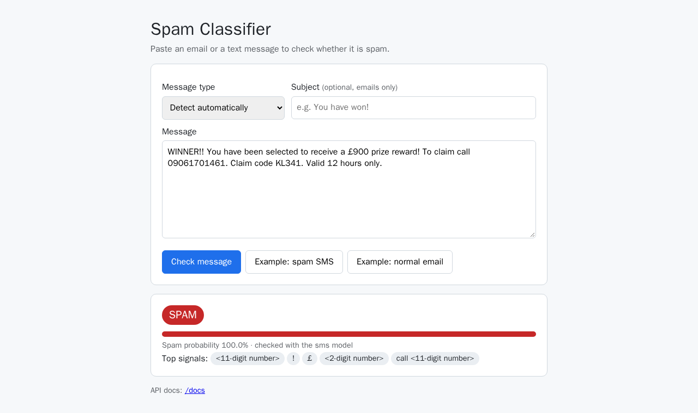
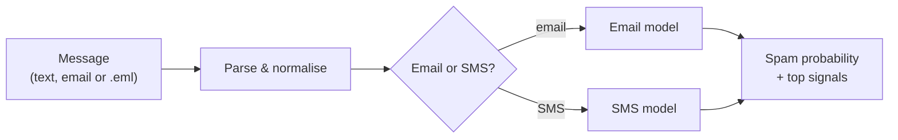

# Spam Classifier for Emails & SMS

[](https://github.com/ashutoshbang/spam-classifier/actions/workflows/ci.yml)

Detect spam in **emails** and **text messages (SMS)** with a fast, explainable machine-learning model.
Comes with a REST API, a web UI, a command-line tool and a Docker image. No API keys or GPU needed: the
model is ~5 MB and classifies a message in about a millisecond.



## Features

- **Two specialised models**, one for emails and one for SMS, with automatic routing between them.
- Accepts plain text, an email body + subject, HTML emails, or a complete raw email (`.eml`); MIME parts,
  encoded headers and HTML are handled and attachments are ignored.
- **Explains every decision** with the words and phrases that influenced it the most.
- REST API (FastAPI) with interactive docs, a small web UI, a CLI and a Python API.
- **~99% F1 on held-out emails and ~96% on held-out SMS** (see [Results](#results)).
- Reproducible training: datasets are downloaded from pinned URLs and verified with SHA-256.
- Test suite, GitHub Actions CI and a Dockerfile.

## Quick start

Requires Python 3.12+. The trained model is included in the repository, so no training is needed.

```bash
git clone https://github.com/ashutoshbang/spam-classifier.git
cd spam-classifier
python -m venv .venv
source .venv/bin/activate          # Windows: .venv\Scripts\activate
pip install -r requirements.txt
```

### Web UI and REST API

```bash
uvicorn spam_classifier.api:app
```

Open <http://127.0.0.1:8000> for the web UI or <http://127.0.0.1:8000/docs> for the interactive API docs.

```bash
curl -s http://127.0.0.1:8000/predict \
  -H "Content-Type: application/json" \
  -d '{"text": "WINNER!! You have been selected to receive a £900 prize reward! To claim call 09061701461."}'
```

```json
{"label":"spam","is_spam":true,"spam_probability":0.9997,"channel":"sms","top_signals":["<11-digit number>","!","£","call <11-digit number>","you have"]}
```

```bash
curl -s http://127.0.0.1:8000/predict \
  -H "Content-Type: application/json" \
  -d '{"subject": "Project update", "text": "Hi Sam,\nThe deployment went fine. I will send the notes tomorrow.\nThanks,\nPriya"}'
```

```json
{"label":"ham","is_spam":false,"spam_probability":0.0001,"channel":"email","top_signals":["i","thanks","the","fine","project"]}
```

| Method | Path             | Description                                                          |
|--------|------------------|----------------------------------------------------------------------|
| GET    | `/`              | Web UI                                                               |
| GET    | `/docs`          | Interactive API documentation                                        |
| GET    | `/health`        | Status, version, decision threshold and when the model was trained   |
| POST   | `/predict`       | Classify one message                                                 |
| POST   | `/predict/batch` | Classify up to 100 messages: `{"items": [{"text": "..."}, ...]}`     |

**Request fields**

| Field     | Required | Description                                                                              |
|-----------|----------|------------------------------------------------------------------------------------------|
| `text`    | yes      | SMS text, email body, or a complete raw email (`.eml` contents); up to 100,000 characters |
| `subject` | no       | Email subject, if it is not already part of `text`                                       |
| `channel` | no       | `auto` (default), `email` or `sms`: which model to use                                   |

**Response fields**

| Field              | Description                                                                                  |
|--------------------|----------------------------------------------------------------------------------------------|
| `label`            | `spam` or `ham` (not spam)                                                                   |
| `is_spam`          | `true` when `spam_probability` is at least the threshold (default 0.5)                       |
| `spam_probability` | Probability that the message is spam, from 0 to 1                                            |
| `channel`          | The model that was used: `email` or `sms`                                                    |
| `top_signals`      | Up to 5 words/phrases that pushed the decision the most (numbers shown as `<6-digit number>`) |

### Command line

```bash
python -m spam_classifier "Congratulations! You've won a FREE iPhone. Click http://bit.ly/x to claim now"
# SPAM  (89.6% spam probability, sms model)
# signals: free, http, !, a free, now

python -m spam_classifier --file message.eml        # a raw email saved from your mail client
echo "are we still on for dinner tonight?" | python -m spam_classifier --json
```

Options: `--subject`, `--channel {auto,email,sms}`, `--json`, `--model PATH`.

### Python

```python
from spam_classifier.model import SpamClassifier

classifier = SpamClassifier.load()
result = classifier.predict("Hi Sam,\nThe deployment went fine.\nThanks", subject="Project update")
print(result.label, result.spam_probability, result.top_signals)
```

### Docker

```bash
docker build -t spam-classifier .
docker run --rm -p 8000:8000 spam-classifier
```

### Configuration

| Environment variable | Default                         | Description                                                                                                 |
|----------------------|---------------------------------|-------------------------------------------------------------------------------------------------------------|
| `SPAM_MODEL_PATH`    | `models/spam_classifier.joblib` | Model bundle to load                                                                                        |
| `SPAM_THRESHOLD`     | `0.5`                           | Spam probability needed to label a message as spam. Raise it (e.g. `0.8`) to flag fewer legitimate messages |

## How it works



1. **Parsing.** Raw emails are parsed with Python's `email` package: encoded subjects, multipart bodies
   (plain text preferred, HTML converted to text) and attachments are skipped. Link targets are kept,
   because they are a strong spam signal.
2. **Normalisation.** Text is Unicode-normalised and lower-cased, and every number is replaced by its length
   (`09061701461` becomes `<11-digit number>`). The model learns that premium-rate phone numbers and 5-digit
   short codes are suspicious without memorising specific numbers, and a 6-digit login code doesn't look like a
   phone number.
3. **Routing.** With `channel=auto`, messages that have a subject, several lines, HTML, email headers or more
   than 300 characters go to the email model; short single-line messages go to the SMS model.
4. **Classification.** Each channel has its own scikit-learn pipeline: TF-IDF word 1–2-grams and character
   2–5-grams feeding a logistic regression with balanced class weights. `top_signals` are the word n-grams with
   the largest contribution (TF-IDF weight × coefficient) towards the predicted label.

**Why two models?** SMS and email look very different. The email model, which is trained on all three datasets,
wrongly flags 1.6% of the legitimate text messages in the test set as spam; the dedicated SMS model flags only
0.2%. The email model still learns from the SMS data so short, casual personal emails ("Hi Mom, landed
safely…") aren't mistaken for spam.

## Results

Measured on a held-out 20% of the de-duplicated data that the models never saw during training:

| Model | Test set              | Messages | Precision | Recall |    F1 | ROC AUC | False positive rate |
|-------|-----------------------|---------:|----------:|-------:|------:|--------:|--------------------:|
| Email | Enron + SpamAssassin  |    7,012 |     0.992 |  0.988 | 0.990 |  0.9995 |               0.69% |
| Email | Enron-Spam only       |    5,835 |     0.993 |  0.990 | 0.992 |  0.9996 |               0.65% |
| Email | SpamAssassin only     |    1,177 |     0.980 |  0.975 | 0.978 |  0.9989 |               0.85% |
| SMS   | SMS Spam Collection   |    1,027 |     0.983 |  0.935 | 0.959 |  0.9864 |               0.22% |

*Precision*: of the messages flagged as spam, the share that really were spam. *Recall*: the share of spam that
was caught. *False positive rate*: the share of legitimate messages wrongly flagged as spam. Full metrics,
including confusion matrices, are in [`models/metrics.json`](models/metrics.json).

## Training your own model

```bash
python -m spam_classifier.train
```

This downloads the three datasets (~43 MB, cached in `data/raw/` and verified with SHA-256), removes duplicate
messages, holds out 20% for testing, trains both models (a minute or two on a laptop) and writes
`models/spam_classifier.joblib` and `models/metrics.json`. Options: `--test-size`, `--seed`, `--threshold`,
`--output`, `--metrics`, `--data-dir`.

> [!NOTE]
> The model bundle is a pickle (joblib): only load model files you trust, and load them with the scikit-learn
> version pinned in `requirements.txt`.

## Development

```bash
pip install -r requirements-dev.txt
pytest
ruff check . && ruff format --check .
```

```text
spam_classifier/
├── preprocess.py      # email/HTML parsing and text normalisation
├── model.py           # pipelines, channel routing, SpamClassifier (load / predict / explain)
├── data.py            # dataset download (pinned + checksummed) and loading
├── train.py           # training and evaluation
├── api.py             # FastAPI app (REST API + web UI)
├── cli.py             # command-line interface
└── static/index.html  # web UI
models/                # trained model bundle and its metrics
tests/                 # pytest suite
```

## Limitations

- The training data is English and dated: Enron and SpamAssassin emails are from the early 2000s and the SMS
  collection is from 2012. Newer scam styles and other languages may be missed, so retrain with your own data
  for best results.
- Only the message content is used. Sender reputation, SPF/DKIM, real link destinations and attachments are not.
- It's a compact learning project and a useful extra signal, not a replacement for a production mail filter.

## Datasets and credits

- **SMS Spam Collection**: T. A. Almeida, J. M. Gómez Hidalgo and A. Yamakami, *Contributions to the Study of
  SMS Spam Filtering: New Collection and Results*, DocEng 2011
  ([UCI Machine Learning Repository](https://archive.ics.uci.edu/dataset/228/sms+spam+collection), CC BY 4.0).
- **Enron-Spam**: V. Metsis, I. Androutsopoulos and G. Paliouras, *Spam Filtering with Naive Bayes – Which
  Naive Bayes?*, CEAS 2006 (CSV version from [MWiechmann/enron_spam_data](https://github.com/MWiechmann/enron_spam_data)).
- **SpamAssassin public corpus**: the [Apache SpamAssassin](https://spamassassin.apache.org/) project
  (mirror: [dmitrynogin/SpamAssassin](https://github.com/dmitrynogin/SpamAssassin)).

The datasets are downloaded at training time from the URLs pinned in
[`spam_classifier/data.py`](spam_classifier/data.py) and are not redistributed in this repository.
